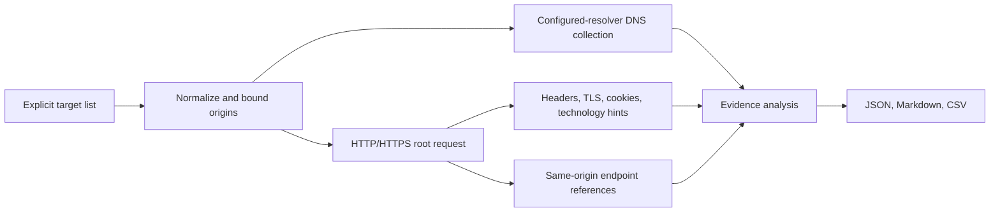

# Web Security Reconnaissance Tool


[CI workflow](.github/workflows/ci.yml)

A modular, bounded reconnaissance utility for explicitly authorized web targets. It collects common
DNS records, HTTP/HTTPS response metadata, selected technology fingerprints, cookie security
attributes, TLS certificate details when available, and endpoint references from the homepage,
`robots.txt`, sitemaps, and API documentation. It exports structured JSON plus readable Markdown and
CSV findings.

> **Authorization required.** Use it only on systems you own or have explicit permission to assess.
> Every run requires `--authorized`; that acknowledgment is not a replacement for the target
> owner's written rules of engagement.

## Capabilities

- DNS A, AAAA, CNAME, MX, NS, TXT, CAA, SOA, DMARC TXT, and IP PTR collection through the system's
  configured DNS resolver.
- HTTP/HTTPS status, selected headers, redirect same-origin status, and TLS certificate metadata.
- Technology hints from server headers, common framework asset paths, cookies, and HTML generator
  metadata. Fingerprints are indicative and may be false positives.
- Cookie attribute review (`Secure`, `HttpOnly`, `SameSite`) without retaining cookie values.
- Bounded endpoint references from same-origin HTML links, `robots.txt`, sitemaps, and a small set
  of standard API/documentation paths. Endpoint references discovered in content are recorded but
  not fetched.
- Evidence-based review leads for missing browser security headers, cookie attributes, short-lived
  certificates, and absent email-domain policies.
- Atomic JSON, Markdown, and CSV report output; CSV formula-like cells are protected.

The tool does not enumerate subdomains, brute-force DNS, crawl links, probe `robots.txt` disallowed
paths, send credentials, submit forms, fuzz, exploit, follow redirects, or map banners to CVEs. The
homepage and explicitly listed metadata endpoints are requested only with bounded timeouts and at
most 256 KiB of response body per request. Redirects are recorded and left for manual review.

## Requirements

- Python 3.11 or newer
- Linux recommended for the intended assessment workflow; tests also run on Windows and macOS
- Requests and dnspython are installed with the package

Requests uses explicit connect/read timeouts, response streaming, default TLS certificate
verification, and no environment proxy configuration. See [Requests advanced usage](https://requests.readthedocs.io/en/stable/user/advanced/).

## Install

```bash
python3 -m venv .venv
source .venv/bin/activate
python -m pip install --upgrade pip
python -m pip install .
```

For development tools:

```bash
python -m pip install -e '.[dev]'
```

## Run

One authorized origin:

```bash
webrecon --target https://staging.example.internal --authorized
```

Several origins from a UTF-8 file:

```bash
webrecon --target-file examples/targets.example.txt --authorized --output-dir reports
```

An HTTP service on a supported alternate web port:

```bash
webrecon --target http://127.0.0.1:8080 --authorized --skip-dns
```

Hostnames without a scheme default to HTTPS. Allowed ports are 80, 443, 3000, 5000, 8000, 8080,
8443, 8888, 9000, and 9443. The timeout must be from 0.5 to 10 seconds. A run accepts at most 25
distinct origins. These bounds keep collection manageable; they do not establish authorization.

Use `--skip-dns` or `--skip-http` to disable one collector. At least one must remain enabled. Run
`webrecon --help` for the complete command options.

## Output

Each run writes three timestamped files under `reports/` or `--output-dir`:

- **JSON** — scan metadata, DNS answers, HTTP/TLS observations, endpoint references, warnings, and
  findings
- **Markdown** — operator-friendly summary and endpoint table
- **CSV** — one row per heuristic finding

The versioned structure is documented in [recon-report.schema.json](schemas/recon-report.schema.json).

The collector does not save page bodies, `Set-Cookie` values, URL query strings, or credentials.
Reports may still reveal internal target names, DNS information, software hints, and endpoint paths;
keep real reports private.

## Collection flow



## Verify

```bash
python -m pytest
ruff check .
```

Tests use mocked DNS and a loopback-only HTTP server. GitHub Actions runs them on Python 3.11, 3.12,
3.13, and 3.14.

Review [SECURITY.md](SECURITY.md) for scope, data handling, and responsible-use details.
